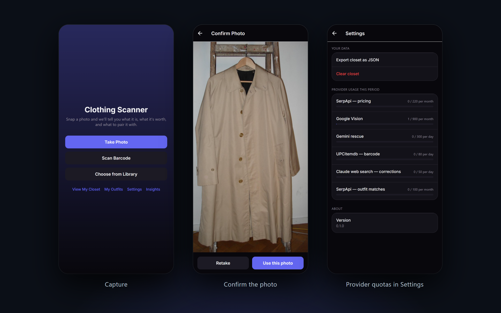
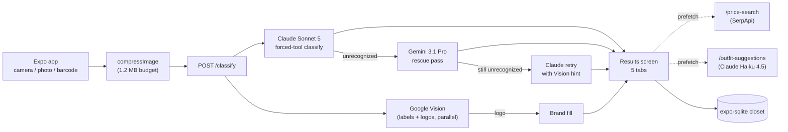
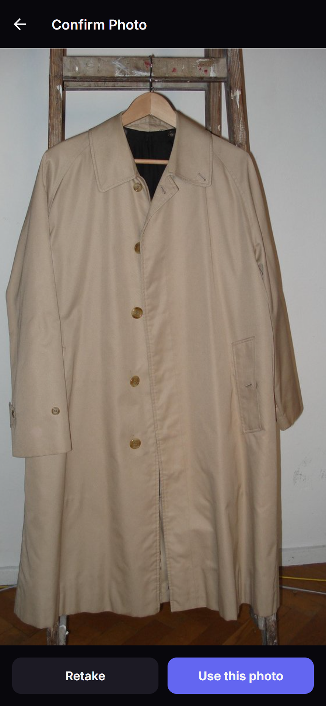
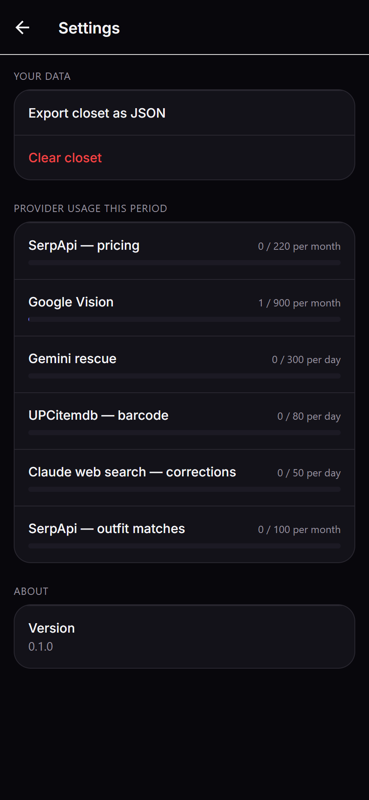
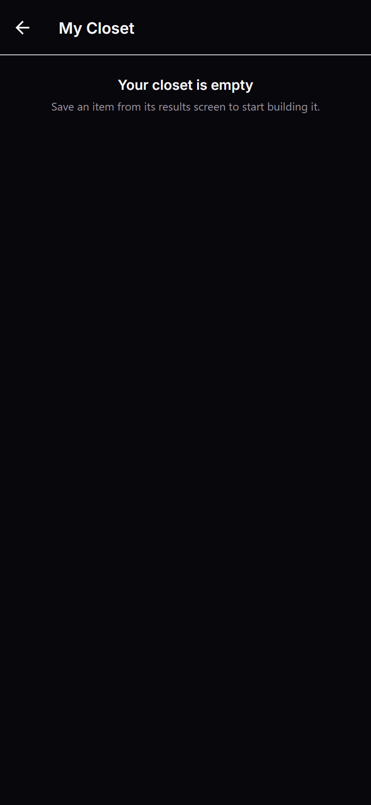
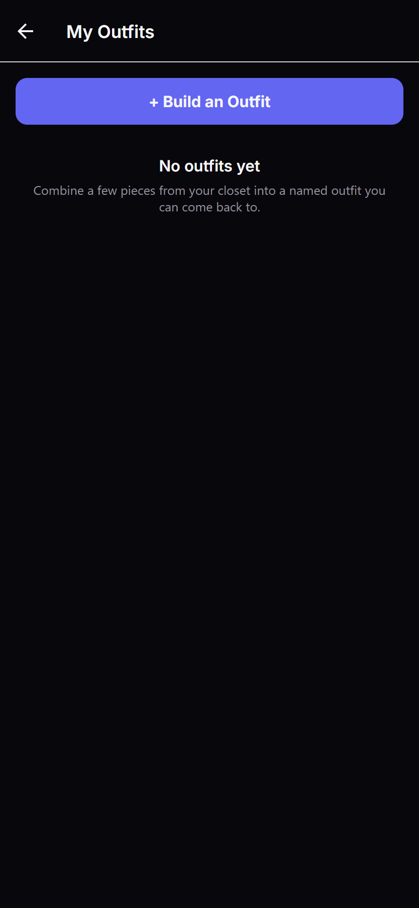
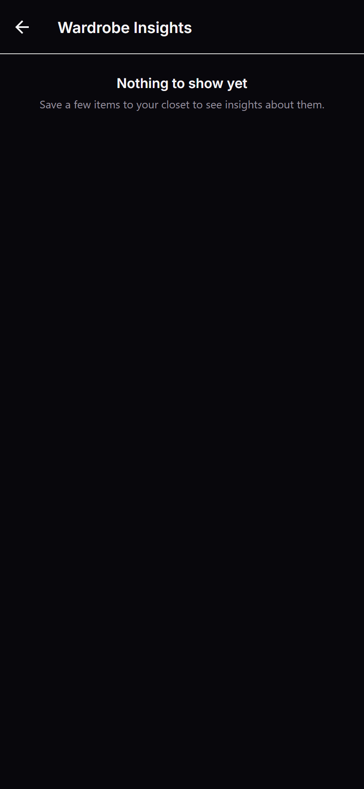

# Clothing Scanner

**Photograph any piece of clothing and get back what it is, what it costs new and resale, what to wear it with, and a closet that tracks cost-per-wear.**

[](https://github.com/benjaminsinger18-arch/clothing-scanner/actions/workflows/ci.yml)
[](LICENSE)


**Live demo:** <https://clothing-scanner-server.vercel.app> (web build; the backend sleeps on Render's free tier, so the first scan can take 20 to 30 seconds to wake it)



## What it does

- **Identifies the garment.** Type, category, color, pattern, style, gender and a brand guess with a stated confidence, from one photo. A barcode on the tag works too.
- **Prices it.** An estimated retail range from live Google Shopping listings, and a resale range when enough secondhand listings turn up. Both are statistically trimmed, not raw min and max.
- **Shows reviews and alternatives.** Rated listings sorted by review count, plus cheaper and pricier options.
- **Suggests outfits.** Complementary pieces with real purchasable matches, gendered correctly.
- **Lets you fix it.** "This isn't right?" takes your correction and verifies it with a web search before saving.
- **Keeps a closet.** Saved items, named outfits built from your own pieces, wear logging, cost-per-wear, and insights such as total value and "haven't worn in 90+ days."

## How it works



The photo is compressed on device, then one request fans out to Claude and Google Vision in parallel. Claude's structured answer is the result on the common path, which keeps a scan at roughly 2 to 3 seconds. Gemini and a Vision-seeded retry run only when Claude cannot identify the item, so their cost is paid on failures, not on every scan. The moment a classification resolves, the app prefetches pricing and outfit matches so the Results screen opens with data already in flight.

## Tech stack

| Layer        | Choice                                            | Why                                                                                 |
| ------------ | ------------------------------------------------- | ----------------------------------------------------------------------------------- |
| App          | Expo SDK 54, React Native 0.81, React 19          | One codebase for iOS, Android and the web build on Vercel                           |
| Local data   | expo-sqlite                                       | Closet, outfits and wear log stay on the device; no account needed                  |
| Backend      | Express 4, TypeScript, Node 22                    | Small, typed API that fronts four paid providers behind one shared secret           |
| Vision       | Claude Sonnet 5, Google Vision, Gemini 3.1 Pro    | Structured identification, logo-based brand fill, and an independent rescue opinion |
| Pricing      | SerpApi (Google Shopping)                         | One source for retail, resale, reviews and outfit matches                           |
| Shared types | `packages/shared-types`                           | App and server compile against the same `ClassificationResult`                      |
| Quality      | ESLint 9, Prettier, husky, Vitest, GitHub Actions | Typecheck, lint, format-check and test on every push                                |

## Quickstart

```bash
git clone https://github.com/benjaminsinger18-arch/clothing-scanner.git
cd clothing-scanner && npm install
cp server/.env.example server/.env     # add ANTHROPIC_API_KEY (SERPAPI_KEY for pricing)
npm run server:dev                     # API on http://localhost:3000
cd app && npx expo start --web         # or `npx expo start` and scan with Expo Go
```

Phone setup, Render and Vercel deployment, EAS builds and the full key table are in [docs/SETUP.md](docs/SETUP.md).

## Screenshots

<details>
<summary>Confirm photo</summary>



</details>

<details>
<summary>Settings with live provider quotas</summary>



</details>

<details>
<summary>Closet, outfits and insights</summary>





</details>

## Engineering highlights

- **81-image golden eval set** of CC-licensed photos across all 8 categories, with a runner that grades every field, estimates the dollar cost of the run, and can gate on a minimum pass rate. Verified user corrections can be promoted into the set with one command. See [docs/EVAL.md](docs/EVAL.md).
- **Measured, not guessed.** Gemini moved from every-scan to rescue-only after live timing showed it turned a steady 2.5-second scan into an unpredictable 3 to 8 seconds. Every classification logs latency and token usage so the next decision can be measured too.
- **Price ranges that behave.** IQR outlier removal, a percentile trim and a median cap, each covering a case the others miss, with unit tests on the math.
- **Quota as a first-class concern.** Per-provider soft caps with headroom under every free tier, a `/usage` endpoint, and in-app quota bars.
- **Shared-secret auth, image budget, TTL cache.** The deployed API rejects unauthenticated calls to paid endpoints, the client never sends more than 1.2 MB, and UPC lookups are cached.
- **Logs that survive free hosting.** Correction and classification logs sync to a Hugging Face bucket so Render restarts do not erase them.
- **CI across three workspaces.** Typecheck, lint, format-check and 41 unit tests on every push.

## Roadmap

- App-side tests for the closet and wear-log storage.
- Run the eval harness in CI once a measured pass-rate baseline exists.
- Per-user auth before any public release.
- Replace the placeholder bundle identifier and submit to the stores.

## Docs

- [Setup](docs/SETUP.md): local run, phone, web build, Render, Vercel, EAS, API keys
- [API](docs/API.md): every endpoint with request and response shapes
- [Eval](docs/EVAL.md): golden set, runner, logs, promoting corrections
- [Troubleshooting](docs/TROUBLESHOOTING.md)
- [History](docs/HISTORY.md): how it was built, phase by phase

## License

MIT, Benjamin Singer. See [LICENSE](LICENSE). Golden-set photos are CC-licensed from Wikimedia Commons; see `server/eval/golden/ATTRIBUTIONS.md`.
